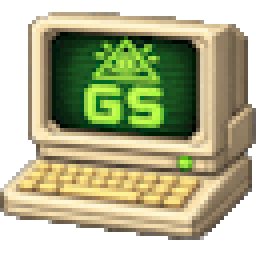
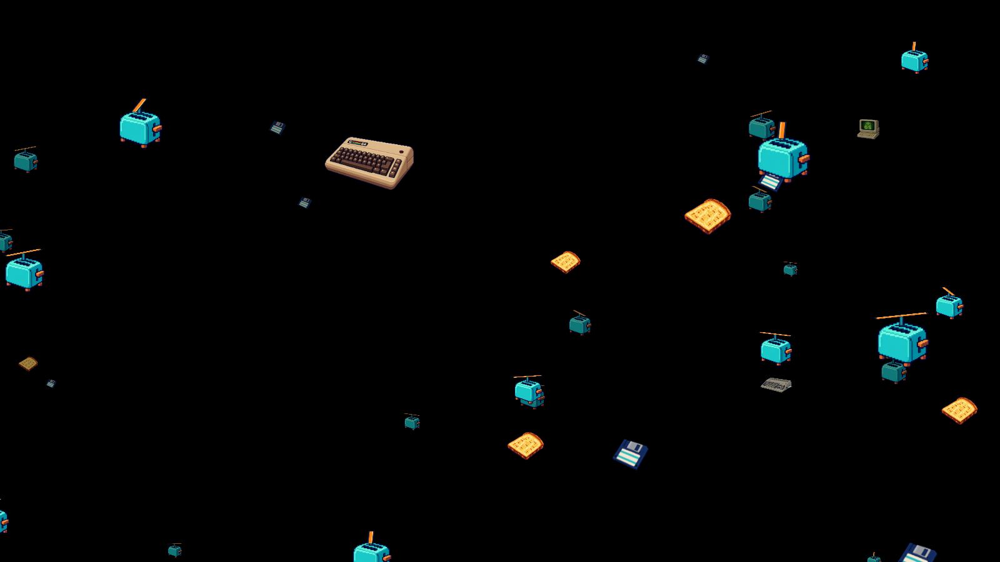

# GruetzeToaster



A retro screensaver with turquoise propeller toasters, golden toast, logo computers and a parallax effect.
Developed by **Grütze-Software** using C#, **.NET 10 LTS** and **Avalonia 12.1.4**.
The application interface and documentation are in English.



## Retro companions

Settings has two independent, optional switches (both off by default):

- **Include C64-inspired computer**: a recognizable brown breadbin keyboard computer with a blinking red power light.
- **Include Amiga-inspired computer**: a cream Amiga 500-style computer whose small floppy disk slides out of the side drive and back in.

Toast and standalone floppy disks fly alongside the toasters. Optional computers are rare visitors
(about 9% of the random selection with both enabled). Each enabled computer is included at least once
when the object count allows it; all sprites share the configured total object count.

Existing settings files remain compatible. Reset turns both extras off again.
The application icon is the project owner's existing logo computer.

## Download and install 1.1.0

Download the package for your system from [Release 1.1.0](https://github.com/gruetze-software/GruetzeToaster/releases/tag/v1.1.0).
Release packages include the .NET runtime; installing the SDK or runtime separately is unnecessary.
`SHA256SUMS.txt` contains checksums for the downloads.

| System | Download |
| --- | --- |
| Windows x64 | `GruetzeToaster-1.1.0-windows-x64.zip` |
| Linux x64 | `GruetzeToaster-1.1.0-linux-x64.tar.gz` or `.deb` |
| Linux ARM64 | `GruetzeToaster-1.1.0-linux-arm64.tar.gz` or `.deb` |
| macOS Apple Silicon (M-series) | `GruetzeToaster-1.1.0-macos-arm64.zip` |
| macOS Intel | `GruetzeToaster-1.1.0-macos-x64.zip` |

### Windows

Extract the entire ZIP to a permanent folder. Use `Settings.cmd` to configure it, `About.cmd` for
project information, or `Windowed.cmd` to try it. `Fullscreen.cmd` starts the animation on all screens.
To register it as a Windows screensaver, right-click `gruetzetoaster.scr` and choose **Install**
(you may need **Show more options**). Keep every dependency beside the SCR file; do not copy it alone to System32.
The executable is not Authenticode-signed, so Windows may display a publisher/reputation warning.

### macOS: installation and launch

The bundle declares **macOS 14 or later** as its minimum. Use the download matching your Mac's chip
(Apple menu → **About This Mac**). Runtime support also follows
[Microsoft's supported macOS versions](https://learn.microsoft.com/en-us/dotnet/core/install/macos).

1. Open the ZIP in Finder and drag **GruetzeToaster.app** into **Applications**.
2. Double-click the app to start fullscreen. Move the mouse, click, or press Escape to quit; **F** toggles the performance display.
3. These builds are ad-hoc signed, without an Apple Developer ID or notarization. If macOS blocks the
   first launch and you trust this download, try opening it once, then go to **System Settings → Privacy & Security → Open Anyway**
   and confirm. Follow [Apple's instructions](https://support.apple.com/en-us/102445).

To open settings, About, or a normal window, close any running fullscreen instance and use Terminal:

```sh
open -a /Applications/GruetzeToaster.app --args --settings
open -a /Applications/GruetzeToaster.app --args --about
open -a /Applications/GruetzeToaster.app --args --windowed
```

**macOS runs this as a standalone app.** It does not appear in System Settings → Screen Saver,
does not activate automatically when idle, and does not lock the Mac. There is no native `.saver` extension.
The bundle is built and signature-checked on macOS in CI; interactive testing on Intel and Apple Silicon Macs is still needed.

### Linux

For Debian/Ubuntu, install the DEB matching your architecture (the package manager resolves native dependencies):

```sh
sudo apt install ./GruetzeToaster-1.1.0-linux-x64.deb
gruetzetoaster --settings
gruetzetoaster --windowed
```

For the TAR.GZ, extract it and run `./gruetzetoaster --windowed` from that directory. Keep the files together.
Linux packages require glibc and native desktop libraries; see the DEB dependency list in `scripts/build-linux.sh`.
With no arguments, the app starts fullscreen. It is a standalone animation, without automatic idle activation or session locking.
Snap and Flatpak are preparation templates only; 1.1.0 does not publish packages to those stores.

## Try it locally on Windows

Building from source requires the .NET 10 SDK.

```powershell
dotnet test GruetzeToaster.sln -c Release
powershell -NoProfile -File scripts/build-windows.ps1
```

The `artifacts/windows-local` folder will contain:

- `Settings.cmd`: object count (1–200 per screen), speed and frame rate display.
- `About.cmd`: project information, GitHub and Ko-fi.
- `Windowed.cmd`: animation in a normal window; press Escape to close.
- `Fullscreen.cmd`: fullscreen animation on the available screens.
- `gruetzetoaster.scr`: the local Windows screensaver executable; it also needs the other files in this folder.

The default local build requires the installed .NET 10 runtime (Microsoft.NETCore.App is sufficient for Avalonia).
For a build that includes the runtime, use `powershell -NoProfile -File scripts/build-windows.ps1 -SelfContained`.
To test the Windows preview, right-click the SCR file and choose Configure or Install (the labels follow your Windows language).
Keep the SCR file together with its dependencies; do not copy it to System32 on its own.

In fullscreen mode, moving the mouse more than 10 logical pixels, clicking or pressing a key exits the animation.
**F** toggles the frame rate display. Closing one fullscreen window closes all windows started in that session.
In windowed mode, normal mouse and keyboard input does not exit the animation; Escape closes the window.

## Platform status

| Platform | Implemented | Still to test / limitations |
| --- | --- | --- |
| Windows | Fullscreen, windowed mode, settings, About, SCR arguments, preview, multiple monitors | Manual testing with the Windows screensaver dialog and mixed display scaling |
| Linux / X11 and XWayland | GPU rendering with software fallback, fullscreen, windowed mode, multiple monitors | Runtime testing on a real Linux desktop |
| Linux / native Wayland | Automatic selection when WAYLAND_DISPLAY is set; explicit --wayland option | GNOME/KDE, drivers and sandbox testing; currently one fullscreen window, with its target monitor chosen by the compositor |
| macOS Intel / Apple Silicon | Separate self-contained app bundles, macOS packaging and signature checks | Interactive testing on Macs; ad-hoc signing only; no native .saver extension |
| Snap / Flatpak | Local package templates and payload preparation script | Not yet built, store-reviewed or published |

The animation does not lock your computer. On Linux and macOS it is a standalone application;
idle activation and integration with the system screensaver are not implemented.
Native Wayland clients cannot generally force window position or always-on-top behavior.
A macOS application bundle is not a ScreenSaverView extension.

## Command-line options

```text
gruetzetoaster --settings
gruetzetoaster --about
gruetzetoaster --windowed
gruetzetoaster --fullscreen
gruetzetoaster --help
```

With no arguments, the app starts the fullscreen animation.
Windows also supports `/s`, `/c`, `/c:HWND`, `/p HWND` and `/p:HWND`.
Preview arguments are accepted only on Windows. Invalid arguments return exit code 2 instead of crashing.
For text output in a Windows terminal, use `dotnet gruetzetoaster.dll --help`.

From PowerShell, a quoted executable path needs the call operator:

```powershell
& ".\gruetzetoaster.exe" --settings
```

Linux selects native Wayland when `WAYLAND_DISPLAY` is set, and X11 otherwise.
Use `--x11` or `--wayland` to select a backend explicitly:

```sh
./gruetzetoaster --windowed --wayland
./gruetzetoaster --windowed --x11
```

The native Wayland backend is still young. If problems occur, compare it with XWayland using `--x11`.
A failed Wayland startup does not automatically switch to X11.
See the official [Avalonia Linux documentation](https://docs.avaloniaui.net/docs/platform-specific-guides/linux).

## Settings and data

The app stores `GruetzeToaster/settings.json` in the operating system's ApplicationData directory:

- Windows: usually `%APPDATA%\GruetzeToaster\settings.json`.
- Linux: usually `$XDG_CONFIG_HOME/GruetzeToaster/settings.json` or `~/.config/GruetzeToaster/settings.json`.
- macOS: usually `~/Library/Application Support/GruetzeToaster/settings.json`.

Flatpak and Snap use their respective private configuration directories.
Object count and speed are validated when settings are loaded. Corrupt files are preserved for diagnosis.
Saving writes a temporary file in the same directory and then replaces the settings file.
Errors appear in the Settings window. Starting the app with missing settings does not create a file.

The animation requires no network access. External links open through the system launcher only when clicked.
There is no telemetry or automatic downloading.

## Tests and performance

```sh
dotnet test GruetzeToaster.sln -c Release
```

Tests cover command-line arguments, Windows preview variants, configuration limits, corrupt files,
save failures, time-based movement and animation, keyboard behavior, and windows and resources with Avalonia Headless.
CI runs tests on Windows, Linux and macOS. Headless tests validate application logic and rendering;
they do not replace interactive testing on real desktop sessions.

One drawing control renders the scene without per-object controls or layout updates.
Windows share small prepared textures. The propeller rotates continuously and the disk slides with
time-based easing; their movement is independent of discrete GIF frames. Offscreen objects are skipped.
The animation clock is monotonic. Closing a window stops further frame requests.

For manual comparisons, test 35 and 200 objects at 1080p/4K and 60/120/144 Hz,
with one or multiple monitors and GPU/software rendering. Press F for FPS, frame interval p95 and maximum;
monitor CPU and memory separately. These intervals measure animation callbacks, not final display presentation.
A repeatable software-rendering comparison and its limits are documented in [Performance](docs/PERFORMANCE.md).

## Build local packages

All scripts produce local files; none upload packages to stores.

```sh
# On Linux; requires the .NET 10 SDK, tar and dpkg-deb:
bash scripts/build-linux.sh x64
bash scripts/build-linux.sh arm64

# On a Mac; requires the .NET 10 SDK and Apple tools:
bash scripts/build-macos.sh arm64
bash scripts/build-macos.sh x64
```

Output is written to `artifacts`. Linux builds produce TAR.GZ and DEB packages with a desktop entry and native dependencies.
macOS builds produce an application bundle in a ZIP, signed ad hoc locally; there is no Apple Developer signature or notarization.
All runtime files are included in the macOS bundle. Linux packages require a glibc-based distribution.
Native libraries are shipped as files, without requiring an executable extraction cache.

### Flatpak

The local template uses private configuration storage, Wayland/X11, shared IPC and DRI graphics access.
It does not grant unrestricted access to the home directory, network or entire D-Bus.
X11 is explicitly allowed so `--x11` can also be tested in a Wayland session.

```sh
bash scripts/prepare-sandbox.sh flatpak x64
flatpak-builder --user --install --force-clean artifacts/flatpak-build packaging/flatpak/de.gruetze_software.GruetzeToaster.yml
flatpak run de.gruetze_software.GruetzeToaster --windowed
```

Freedesktop SDK and Platform 25.08 must be installed.
The template uses a locally published payload; Flathub submission still requires a reproducible source build.

### Snap

```sh
bash scripts/prepare-sandbox.sh snap x64
snapcraft
```

The template uses `core24`, the GNOME extension and strict confinement.
Snapcraft requires a suitable Linux build environment. The template is marked `devel`.
The GNOME extension supplies desktop/portal integration; test links and private settings inside the installed Snap.
Before preparing another payload, move any existing `artifacts/snap-payload` or `flatpak-payload` directory aside.

## About, support and license

- [GitHub project](https://github.com/gruetze-software/GruetzeToaster)
- [Grütze-Software](https://github.com/gruetze-software)
- [Support development on Ko-fi](https://ko-fi.com/gruetzesoftware)

The About dialog follows the design of [BingWallE](https://github.com/gruetze-software/BingWallE):
product version, Grütze-Software branding, project links and voluntary support.

Source code: [MIT license](LICENSE). Dependencies: [third-party notices](THIRD-PARTY-NOTICES.md).
The current build uses newly generated sprite artwork and the owner's existing logos.
The old reconstructed toaster/toast sprites have been removed from build resources; local backups remain under ignored artifacts.
See the [artwork provenance record](docs/ARTWORK-RIGHTS.md) and [generation prompts](docs/artwork-prompts.json).
This independent project does not imply endorsement by the original hardware manufacturers.

## Application icon

The app uses the owner's existing logo computer (`Assets/logo.gif`) as its window, executable and package icon.
About displays it at 72×72 logical pixels. Settings and About size their height to fit the content without scrollbars.
The About dialog reads the Avalonia version from the loaded assembly.

PNG, ICO and ICNS assets can be recreated with `python scripts/build-icons.py` (requires Pillow).
This is a technical format conversion of the owner's logo, separate from the newly generated animation sprites.
